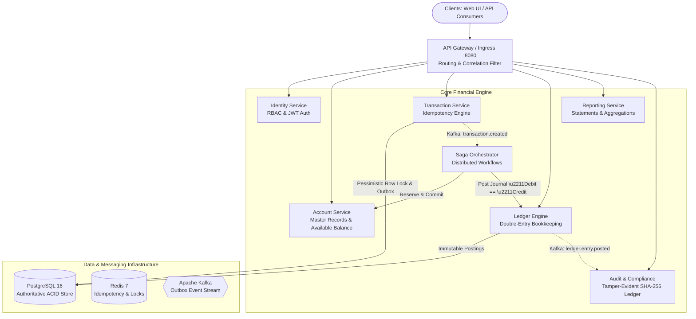

# CLOUDLEDGER
## Cloud-Native Financial Accounting & Distributed Transaction Processing Platform

CloudLedger is an enterprise-grade financial transaction processing and double-entry accounting platform designed for mission-critical core banking and operations teams. It enforces mathematical double-entry invariants, distributed transaction idempotency, transactional outbox event streaming via Apache Kafka, saga compensation workflows, and tamper-evident cryptographic audit logs.

---

## 1. System Architecture



---

## 2. Core Engineering Principles & Invariants

1. **Authoritative Financial Posting:** Kafka event delivery is never treated as equivalent to financial posting. Financial posting is solely authoritative within PostgreSQL ACID transactions.
2. **Double-Entry Invariant:** Every posted journal entry strictly satisfies:
   $$\sum \text{Debits} \equiv \sum \text{Credits}$$
3. **Immutability:** Posted journal entries (`POSTED`) are append-only. Adjustments require auditable inverse entries via `reversal_entries`.
4. **Monetary Precision:** All monetary amounts are processed using `BigDecimal` (Banker's Rounding `HALF_EVEN`) and stored as PostgreSQL `NUMERIC(19,4)`. Floating-point types are banned.
5. **Request Idempotency:** Client submissions include an `Idempotency-Key` header with SHA-256 canonical payload hashing:
   - Identical key + identical payload $\rightarrow$ Safe replay of original result (`Idempotent-Replay: true`).
   - Identical key + differing payload $\rightarrow$ Immediate `HTTP 409 Conflict`.
6. **Concurrency Protection:** Deadlock-free ordered pessimistic row locking (`SELECT FOR UPDATE` sorted by `account_id ASC`) combined with database check constraints prevents negative balance violations under race conditions.
7. **Transactional Outbox & Inbox:** Business mutations and pending events are committed atomically to PostgreSQL; an asynchronous poller publishes events to Kafka with consumer inbox deduplication.
8. **Tamper-Evident Audit Trail:** Every sensitive operation appends a cryptographically linked SHA-256 block (`curr_hash = SHA256(prev_hash + user + action + payload)`).

---

## 3. Technology Stack

- **Backend:** Java 17, Spring Boot 3.3.4, Spring Web, Spring Security, Spring Data JPA, Spring Kafka, Spring Actuator, Flyway.
- **Database & Cache:** PostgreSQL 16 (Authoritative), Redis 7 (Transient locks/rate limits).
- **Messaging:** Apache Kafka 3.6 (KRaft mode), Transactional Outbox Pattern, Consumer Inbox Deduplication.
- **Frontend:** React 18, TypeScript, Vite, Tailwind CSS, Lucide icons.
- **Observability:** Prometheus, Grafana, Micrometer, Structured JSON logs, Correlation IDs.
- **Testing:** JUnit 5, Mockito, Spring Boot Test, k6.
- **Infrastructure:** Docker Compose, AWS Terraform (ECS Fargate, RDS PostgreSQL Multi-AZ, ElastiCache Redis, MSK Kafka).

---

## 4. Local Quick Start (One Command)

### Prerequisites
- Docker & Docker Compose
- Java 17+ and Maven 3.9+ (for local test execution)
- Node.js 20+ (for frontend development)

### Start Full Platform via Docker Compose
```bash
docker-compose up -d --build
```

Service Endpoints:
- **Web Operations Portal:** [http://localhost:3000](http://localhost:3000)
- **REST API & Swagger Docs:** [http://localhost:8080/swagger-ui.html](http://localhost:8080/swagger-ui.html)
- **Actuator Health & Prometheus:** [http://localhost:8080/actuator/prometheus](http://localhost:8080/actuator/prometheus)
- **Kafka UI:** [http://localhost:8085](http://localhost:8085)
- **Prometheus Server:** [http://localhost:9090](http://localhost:9090)
- **Grafana Dashboards:** [http://localhost:3001](http://localhost:3001) (User: `admin`, Password: `admin`)

---

## 5. Demo Credentials (RBAC)

All pre-seeded demo accounts share the password: `password123`

| Username | Role | Capabilities |
| :--- | :--- | :--- |
| `admin` | `ROLE_ADMINISTRATOR` | Full administrative control, freeze/unfreeze accounts, system config. |
| `operator` | `ROLE_FINANCE_OPERATOR` | Ingest transactions, manage accounts, review balances & statements. |
| `approver` | `ROLE_FINANCE_APPROVER` | Reverse transactions, manage high-value exception approvals. |
| `auditor` | `ROLE_AUDITOR` | Read-only ledger explorer, trial balance, and audit trail verification. |

---

## 6. Running Invariant Automated Tests

All automated unit, concurrency, and financial invariant tests can be executed locally:

```bash
# Run backend test suite
mvn test

# Run frontend build
cd frontend
npm run build
```

Test Results Summary:
- `ConcurrentAccountBalanceTest`: Passed! (Verified simultaneous double-withdrawals cannot force negative balances).
- `LedgerEngineInvariantsTest`: Passed! (Verified $\sum \text{Debit} \equiv \sum \text{Credit}$ enforcement and unbalanced rejection).
- `IdempotencyEngineTest`: Passed! (Verified duplicate replays and payload mismatch 409 conflict).
- `TransferSagaCoordinatorTest`: Passed! (Verified multi-step saga workflow and compensation execution).
- `AuditHashChainTest`: Passed! (Verified SHA-256 chain verification and tamper detection).

---

## 7. Synthetic Data Generator

Generate deterministic synthetic accounts and transactions on demand:
```bash
curl -X POST "http://localhost:8080/api/v1/operations/synthetic-data/generate?accounts=100&transactions=500&seed=42"
```

---

## 8. Documentation Index

- [`docs/architecture.md`](docs/architecture.md): Microservice topology and service boundaries.
- [`docs/database-design.md`](docs/database-design.md): Entity relationship diagram and PostgreSQL DDL.
- [`docs/transaction-lifecycle.md`](docs/transaction-lifecycle.md): Transaction states and transition validations.
- [`docs/accounting-model.md`](docs/accounting-model.md): Chart of accounts, normal balances, and reversal entries.
- [`docs/concurrency-control.md`](docs/concurrency-control.md): Pessimistic row locking, sorted lock acquisition, and constraints.
- [`docs/event-driven-design.md`](docs/event-driven-design.md): Transactional outbox pattern and deduplication inbox.
- [`docs/failure-recovery.md`](docs/failure-recovery.md): Saga state machine and compensation procedures.
- [`docs/security.md`](docs/security.md): RBAC matrix and tamper-evident SHA-256 audit chaining.
- [`docs/testing.md`](docs/testing.md): Test invariant matrix and test execution.
- [`docs/performance.md`](docs/performance.md): Latency targets and k6 benchmark script.
- [`docs/aws-deployment.md`](docs/aws-deployment.md): Terraform configuration and AWS cloud topology.
