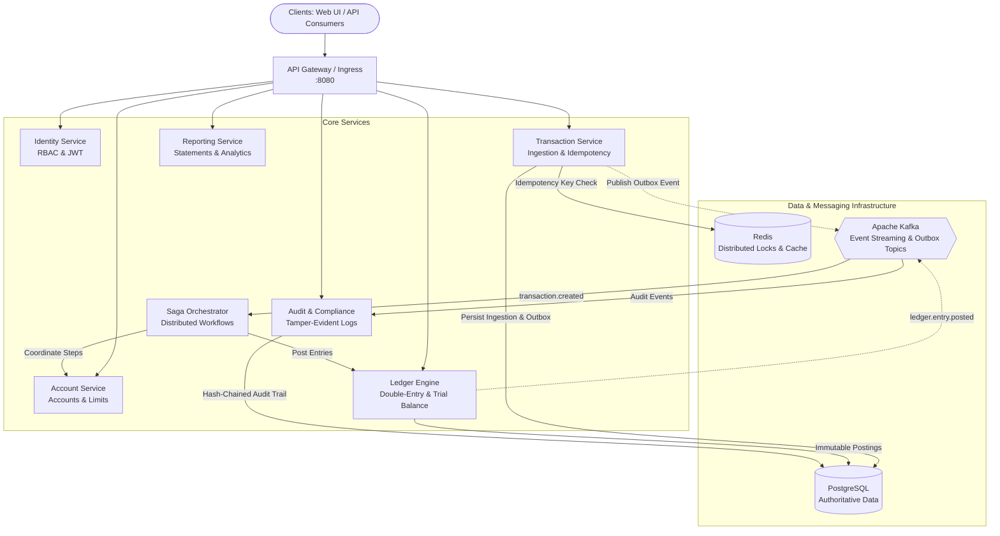

# CloudLedger Architecture Specification

## 1. System Overview

CloudLedger is a cloud-native, distributed financial accounting and transaction processing platform. It enforces strict double-entry accounting invariants, resilient transaction ingestion, cryptographic/hash-chained audit trails, and transactional outbox event publishing via Apache Kafka.

## 2. Service Boundaries & Responsibilities

| Service | Bounded Context | Authoritative Storage | Key Invariants |
| :--- | :--- | :--- | :--- |
| **API Gateway** | Routing, Security, Rate Limiting | Stateless / Redis Rate Limits | Injects `X-Correlation-ID`, terminates TLS, enforces JWT validation. |
| **Identity Service** | Auth, Users, Roles | `users`, `roles`, `user_roles` | BCrypt password hashing, stateless JWT with refresh token rotation. |
| **Account Service** | Account Master, Status, Balances | `accounts`, `account_holders` | Balance snapshots, account freeze/unfreeze status validation. |
| **Transaction Service** | Ingestion, Idempotency, Outbox | `transactions`, `transaction_idempotency`, `outbox_events` | Idempotency key uniqueness, request payload hashing (SHA-256), atomic outbox write. |
| **Ledger Engine** | Double-Entry Bookkeeping | `journal_entries`, `journal_entry_lines`, `ledger_postings` | $\sum \text{Debit} \equiv \sum \text{Credit}$, immutability of posted journals, `NUMERIC(19,4)`. |
| **Saga Orchestrator** | Distributed Workflow Execution | `saga_instances`, `saga_steps` | State machine persistence, compensating transaction execution on failure. |
| **Reporting Service** | Read-Optimized Views | Read-replica / Aggregated Snapshots | Trial balance calculation, statements, daily volume aggregates. |
| **Audit Service** | Operational Audit & Compliance | `audit_logs` | Tamper-evident SHA-256 hash chaining of audit events. |

## 3. Communication Patterns

- **Synchronous (REST/HTTP):** Client-to-Gateway, Gateway-to-Services, and query APIs (e.g. balance inquiry, account status).
- **Asynchronous (Kafka & Transactional Outbox):** Cross-service state synchronization (e.g. `transaction.created`, `ledger.entry.posted`).
- **Data Integrity:** PostgreSQL transactions are the sole authority for financial postings. Redis is never used as an authoritative balance store.
