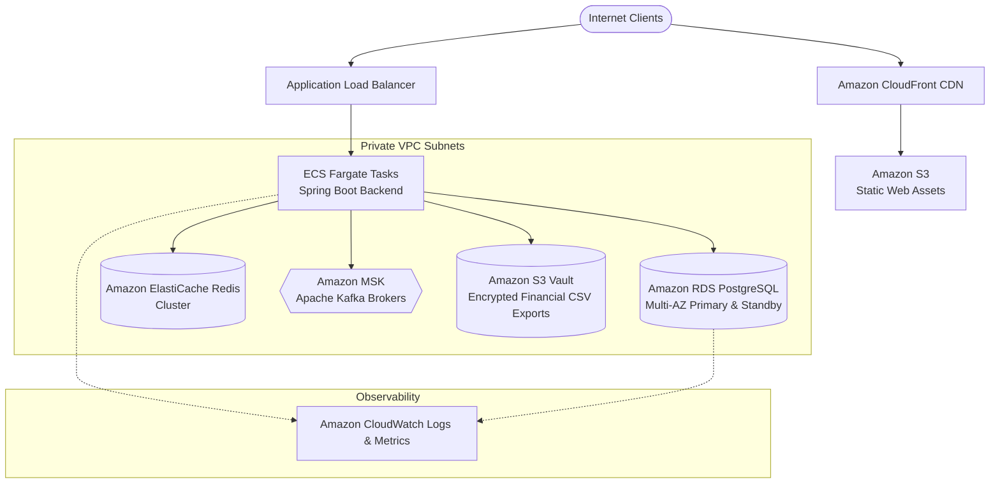

# CloudLedger AWS Cloud Architecture & Deployment Guide

## 1. AWS Topology Architecture



## 2. Infrastructure as Code (Terraform)

The Terraform configuration in `infra/terraform/` defines:
- Multi-AZ Amazon RDS PostgreSQL 16 (`db.t4g.large`) with deletion protection and encrypted storage.
- Amazon ElastiCache Redis 7.1 replication group with in-transit and at-rest encryption.
- Amazon MSK Kafka 3.6.0 with TLS encryption.
- ECS Fargate cluster with Container Insights.
- S3 bucket for financial report exports encrypted with AWS KMS.

```bash
cd infra/terraform
terraform init
terraform plan
terraform apply
```
