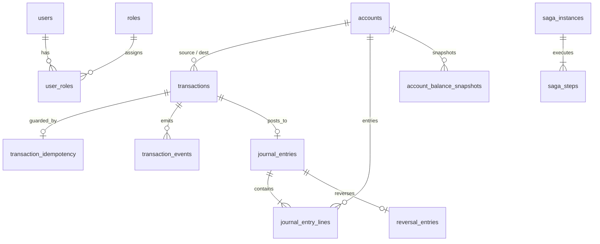

# CloudLedger Authoritative Database Schema Design

## 1. Relational Entity Relationship & Schema Details

All monetary amounts are stored as `NUMERIC(19,4)` to prevent any floating-point truncation issues while providing sub-cent/microunit support if required (with standard currency scale 2 or 4). All timestamps are `TIMESTAMPTZ` (UTC).



## 2. Table Specifications

### 2.1 Identity & Access Management
```sql
CREATE TABLE roles (
    role_id VARCHAR(32) PRIMARY KEY,
    description VARCHAR(255) NOT NULL,
    created_at TIMESTAMPTZ NOT NULL DEFAULT CURRENT_TIMESTAMP
);

CREATE TABLE users (
    user_id UUID PRIMARY KEY DEFAULT gen_random_uuid(),
    username VARCHAR(64) NOT NULL UNIQUE,
    email VARCHAR(128) NOT NULL UNIQUE,
    password_hash VARCHAR(255) NOT NULL,
    status VARCHAR(32) NOT NULL DEFAULT 'ACTIVE',
    created_at TIMESTAMPTZ NOT NULL DEFAULT CURRENT_TIMESTAMP,
    updated_at TIMESTAMPTZ NOT NULL DEFAULT CURRENT_TIMESTAMP
);

CREATE TABLE user_roles (
    user_id UUID NOT NULL REFERENCES users(user_id) ON DELETE CASCADE,
    role_id VARCHAR(32) NOT NULL REFERENCES roles(role_id) ON DELETE CASCADE,
    assigned_at TIMESTAMPTZ NOT NULL DEFAULT CURRENT_TIMESTAMP,
    PRIMARY KEY (user_id, role_id)
);
```

### 2.2 Account Management
```sql
CREATE TYPE account_type_enum AS ENUM ('ASSET', 'LIABILITY', 'EQUITY', 'REVENUE', 'EXPENSE');
CREATE TYPE account_status_enum AS ENUM ('ACTIVE', 'FROZEN', 'CLOSED', 'PENDING_VERIFICATION');

CREATE TABLE accounts (
    account_id UUID PRIMARY KEY DEFAULT gen_random_uuid(),
    account_number VARCHAR(34) NOT NULL UNIQUE,
    account_name VARCHAR(128) NOT NULL,
    customer_reference VARCHAR(64) NOT NULL,
    account_type account_type_enum NOT NULL,
    currency VARCHAR(3) NOT NULL,
    status account_status_enum NOT NULL DEFAULT 'ACTIVE',
    available_balance NUMERIC(19,4) NOT NULL DEFAULT 0.0000,
    ledger_balance NUMERIC(19,4) NOT NULL DEFAULT 0.0000,
    version BIGINT NOT NULL DEFAULT 0,
    created_at TIMESTAMPTZ NOT NULL DEFAULT CURRENT_TIMESTAMP,
    updated_at TIMESTAMPTZ NOT NULL DEFAULT CURRENT_TIMESTAMP,
    CONSTRAINT chk_positive_balances CHECK (
        (account_type IN ('ASSET', 'EXPENSE') AND available_balance >= 0) OR
        (account_type NOT IN ('ASSET', 'EXPENSE'))
    )
);
```

### 2.3 Transaction Engine & Idempotency
```sql
CREATE TYPE transaction_type_enum AS ENUM ('TRANSFER', 'DEPOSIT', 'WITHDRAWAL', 'PAYMENT', 'REVERSAL');
CREATE TYPE transaction_status_enum AS ENUM (
    'RECEIVED', 'VALIDATING', 'PENDING', 'PROCESSING', 'POSTED', 
    'FAILED', 'REQUIRES_REVIEW', 'COMPENSATING', 'REVERSED'
);

CREATE TABLE transactions (
    transaction_id UUID PRIMARY KEY DEFAULT gen_random_uuid(),
    external_reference VARCHAR(64) UNIQUE,
    source_account_id UUID REFERENCES accounts(account_id),
    destination_account_id UUID REFERENCES accounts(account_id),
    amount NUMERIC(19,4) NOT NULL CHECK (amount > 0),
    currency VARCHAR(3) NOT NULL,
    transaction_type transaction_type_enum NOT NULL,
    status transaction_status_enum NOT NULL DEFAULT 'RECEIVED',
    idempotency_key VARCHAR(128) NOT NULL,
    request_reference VARCHAR(128),
    description VARCHAR(255),
    error_code VARCHAR(64),
    error_message TEXT,
    created_at TIMESTAMPTZ NOT NULL DEFAULT CURRENT_TIMESTAMP,
    updated_at TIMESTAMPTZ NOT NULL DEFAULT CURRENT_TIMESTAMP,
    completed_at TIMESTAMPTZ
);

CREATE TABLE transaction_idempotency (
    idempotency_key VARCHAR(128) PRIMARY KEY,
    payload_hash VARCHAR(64) NOT NULL, -- SHA-256 hash of canonical JSON request
    transaction_id UUID NOT NULL REFERENCES transactions(transaction_id),
    status VARCHAR(32) NOT NULL,
    response_payload JSONB,
    created_at TIMESTAMPTZ NOT NULL DEFAULT CURRENT_TIMESTAMP,
    expires_at TIMESTAMPTZ NOT NULL
);

CREATE TABLE transaction_events (
    event_id UUID PRIMARY KEY DEFAULT gen_random_uuid(),
    transaction_id UUID NOT NULL REFERENCES transactions(transaction_id),
    event_type VARCHAR(64) NOT NULL,
    payload JSONB NOT NULL,
    created_at TIMESTAMPTZ NOT NULL DEFAULT CURRENT_TIMESTAMP
);
```

### 2.4 Double-Entry Ledger Engine
```sql
CREATE TYPE journal_status_enum AS ENUM ('DRAFT', 'POSTED', 'REVERSED');
CREATE TYPE entry_direction_enum AS ENUM ('DEBIT', 'CREDIT');

CREATE TABLE journal_entries (
    journal_id UUID PRIMARY KEY DEFAULT gen_random_uuid(),
    transaction_id UUID NOT NULL UNIQUE REFERENCES transactions(transaction_id),
    journal_number VARCHAR(64) NOT NULL UNIQUE,
    description VARCHAR(255) NOT NULL,
    status journal_status_enum NOT NULL DEFAULT 'DRAFT',
    posted_at TIMESTAMPTZ,
    created_at TIMESTAMPTZ NOT NULL DEFAULT CURRENT_TIMESTAMP,
    created_by VARCHAR(64) NOT NULL
);

CREATE TABLE journal_entry_lines (
    line_id UUID PRIMARY KEY DEFAULT gen_random_uuid(),
    journal_id UUID NOT NULL REFERENCES journal_entries(journal_id) ON DELETE RESTRICT,
    account_id UUID NOT NULL REFERENCES accounts(account_id) ON DELETE RESTRICT,
    direction entry_direction_enum NOT NULL,
    amount NUMERIC(19,4) NOT NULL CHECK (amount > 0),
    currency VARCHAR(3) NOT NULL,
    line_order INT NOT NULL,
    created_at TIMESTAMPTZ NOT NULL DEFAULT CURRENT_TIMESTAMP,
    CONSTRAINT uq_journal_line_order UNIQUE (journal_id, line_order)
);

CREATE TABLE reversal_entries (
    reversal_id UUID PRIMARY KEY DEFAULT gen_random_uuid(),
    original_journal_id UUID NOT NULL UNIQUE REFERENCES journal_entries(journal_id),
    reversal_journal_id UUID NOT NULL UNIQUE REFERENCES journal_entries(journal_id),
    reason TEXT NOT NULL,
    reversed_by VARCHAR(64) NOT NULL,
    reversed_at TIMESTAMPTZ NOT NULL DEFAULT CURRENT_TIMESTAMP
);

CREATE TABLE account_balance_snapshots (
    snapshot_id UUID PRIMARY KEY DEFAULT gen_random_uuid(),
    account_id UUID NOT NULL REFERENCES accounts(account_id),
    snapshot_date DATE NOT NULL,
    opening_balance NUMERIC(19,4) NOT NULL,
    closing_balance NUMERIC(19,4) NOT NULL,
    total_debits NUMERIC(19,4) NOT NULL DEFAULT 0,
    total_credits NUMERIC(19,4) NOT NULL DEFAULT 0,
    created_at TIMESTAMPTZ NOT NULL DEFAULT CURRENT_TIMESTAMP,
    CONSTRAINT uq_account_snapshot_date UNIQUE (account_id, snapshot_date)
);
```

### 2.5 Outbox, Inbox & Distributed Saga
```sql
CREATE TABLE outbox_events (
    outbox_id UUID PRIMARY KEY DEFAULT gen_random_uuid(),
    aggregate_type VARCHAR(64) NOT NULL,
    aggregate_id VARCHAR(64) NOT NULL,
    event_type VARCHAR(64) NOT NULL,
    correlation_id VARCHAR(64) NOT NULL,
    payload JSONB NOT NULL,
    status VARCHAR(32) NOT NULL DEFAULT 'PENDING', -- PENDING, PUBLISHED, FAILED
    retry_count INT NOT NULL DEFAULT 0,
    created_at TIMESTAMPTZ NOT NULL DEFAULT CURRENT_TIMESTAMP,
    dispatched_at TIMESTAMPTZ
);

CREATE TABLE consumer_inbox (
    message_id VARCHAR(128) PRIMARY KEY,
    consumer_group VARCHAR(64) NOT NULL,
    status VARCHAR(32) NOT NULL,
    processed_at TIMESTAMPTZ NOT NULL DEFAULT CURRENT_TIMESTAMP
);

CREATE TABLE saga_instances (
    saga_id UUID PRIMARY KEY DEFAULT gen_random_uuid(),
    correlation_id VARCHAR(64) NOT NULL UNIQUE,
    saga_type VARCHAR(64) NOT NULL,
    current_state VARCHAR(64) NOT NULL,
    payload JSONB NOT NULL,
    retry_count INT NOT NULL DEFAULT 0,
    status VARCHAR(32) NOT NULL DEFAULT 'STARTED', -- STARTED, COMPLETED, COMPENSATING, FAILED
    created_at TIMESTAMPTZ NOT NULL DEFAULT CURRENT_TIMESTAMP,
    updated_at TIMESTAMPTZ NOT NULL DEFAULT CURRENT_TIMESTAMP
);

CREATE TABLE saga_steps (
    step_id UUID PRIMARY KEY DEFAULT gen_random_uuid(),
    saga_id UUID NOT NULL REFERENCES saga_instances(saga_id) ON DELETE CASCADE,
    step_name VARCHAR(64) NOT NULL,
    status VARCHAR(32) NOT NULL,
    step_order INT NOT NULL,
    started_at TIMESTAMPTZ NOT NULL DEFAULT CURRENT_TIMESTAMP,
    completed_at TIMESTAMPTZ,
    error_message TEXT
);
```

### 2.6 Tamper-Evident Audit Logs
```sql
CREATE TABLE audit_logs (
    audit_id BIGSERIAL PRIMARY KEY,
    prev_hash VARCHAR(64) NOT NULL, -- SHA-256 of the previous record
    curr_hash VARCHAR(64) NOT NULL, -- SHA-256 of this record's contents + prev_hash
    user_id VARCHAR(64) NOT NULL,
    action VARCHAR(64) NOT NULL,
    entity_type VARCHAR(64) NOT NULL,
    entity_id VARCHAR(64) NOT NULL,
    correlation_id VARCHAR(64),
    ip_address VARCHAR(45),
    details JSONB,
    created_at TIMESTAMPTZ NOT NULL DEFAULT CURRENT_TIMESTAMP
);
CREATE INDEX idx_audit_created_at ON audit_logs(created_at);
```
