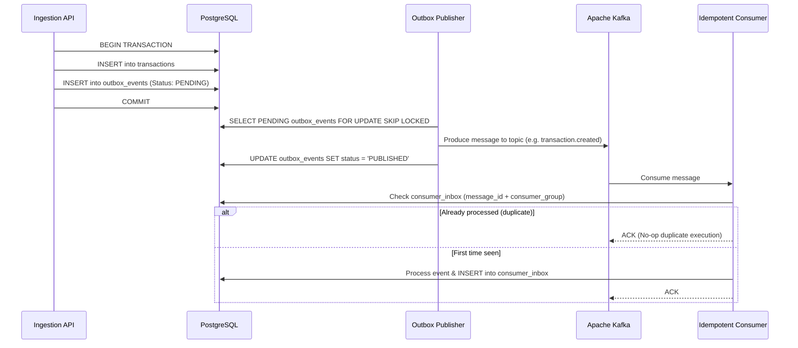

# CloudLedger Event-Driven Architecture & Transactional Outbox

## 1. Architectural Guarantee

Kafka event publishing is **never** treated as equivalent to financial posting. Financial posting is solely authoritative within PostgreSQL ACID boundaries.

To bridge PostgreSQL state changes with Apache Kafka asynchronously and reliably without two-phase commit (XA), CloudLedger implements the **Transactional Outbox Pattern**:

## 2. Topic Catalog

- `transaction.created`: Emitted when an ingested transaction is safely stored.
- `transaction.posted`: Emitted upon authoritative ledger journal commit.
- `transaction.failed`: Emitted on permanent failure or terminal validation rejection.
- `transaction.reversed`: Emitted upon successful auditable compensating reversal.
- `ledger.entry.posted`: Emitted when a double-entry journal is posted.
- `transaction.dead-letter`: Bounded retry failures routed for manual investigation.
