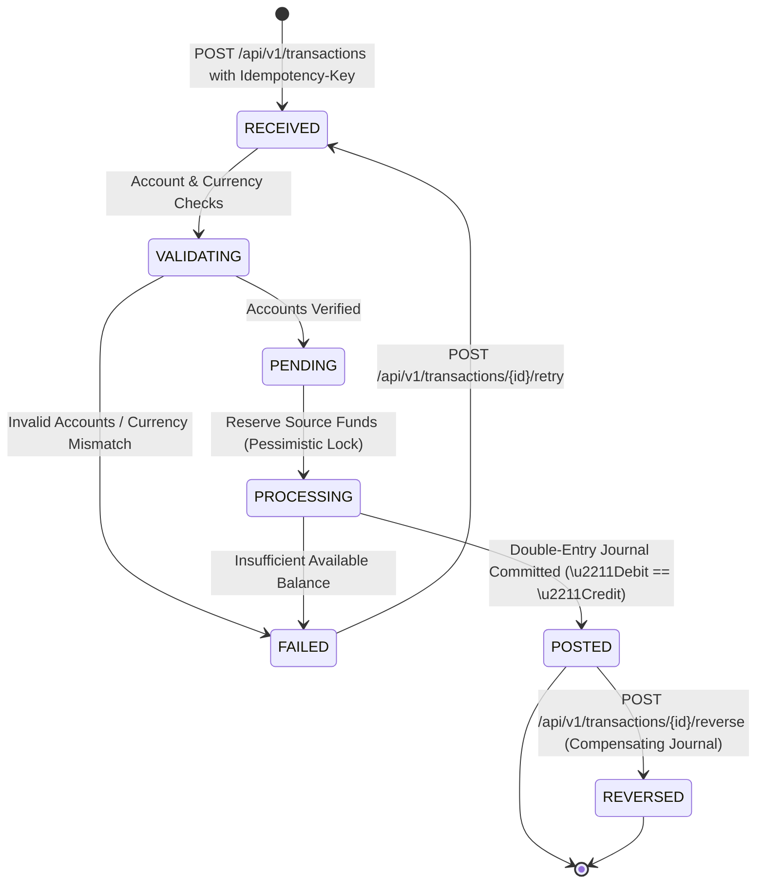

# CloudLedger Transaction Lifecycle Specification

## 1. Overview & State Machine

Every financial transaction ingested by CloudLedger transitions through strictly defined, validated states. Invariants guarantee that duplicate submissions cannot post twice, funds are verified before journal posting, and all state transitions emit transactional outbox events.

## 2. State Descriptions

| Status | Phase | Description |
| :--- | :--- | :--- |
| `RECEIVED` | Ingestion | Request has passed authentication and idempotency check. Transaction and initial outbox event are persisted atomically. |
| `VALIDATING` | Pre-flight | Verifies that source and destination accounts exist, are `ACTIVE`, and match transaction currency. |
| `PENDING` | Pre-flight | Accounts verified; ready for balance reservation under row-level lock. |
| `PROCESSING` | Reservation & Saga | Funds reserved on source account; double-entry journal entry created in `DRAFT` status. |
| `POSTED` | Authoritative Commit | Journal entry posted; $\sum \text{Debit} \equiv \sum \text{Credit}$ verified; ledger balances committed. |
| `FAILED` | Terminal Exception | Failure occurred (e.g. `INSUFFICIENT_FUNDS`). Any temporary reservations are released. |
| `REVERSED` | Compensating Adjustment | An authorized reversal has posted an inverse journal entry via `reversal_entries`. |
